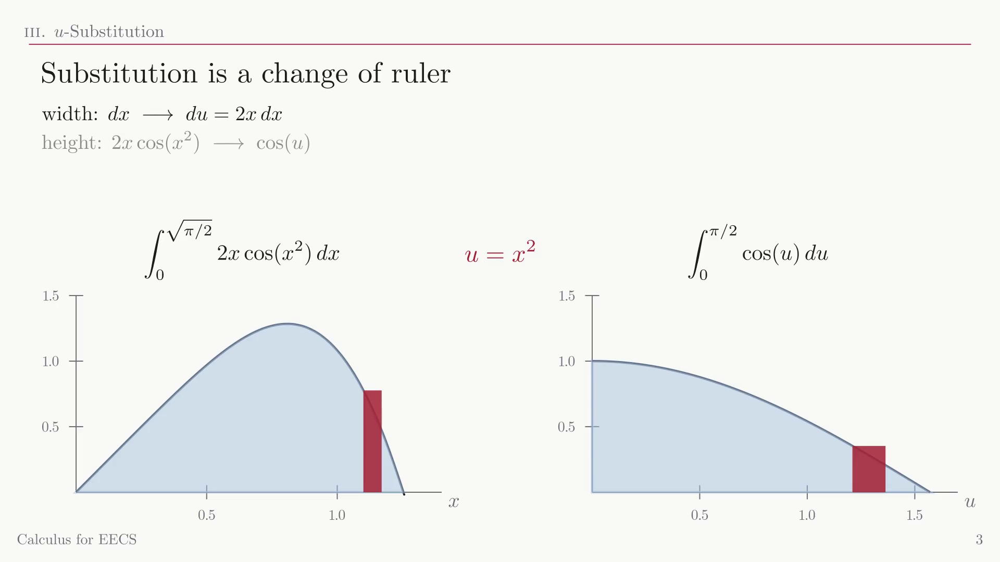

# Deep Dives

Animated explanations of ideas in math and engineering, built with [Manim](https://www.manim.community/) and Blender.

Each folder is one deep dive: the code that generates the visuals, plus the rendered output. The goal is to understand each idea well enough to animate it, and to tie the math to where it shows up in real engineering.

> **Status: work in progress.** This repo is new, and more deep dives are planned.

---

## Contents

| Deep dive | Tools | What it covers |
|---|---|---|
| [Integrals and u-substitution](integrals/) | Manim | Integrals as accumulated area, the Fundamental Theorem of Calculus, why antiderivatives carry a $+C$, and u-substitution as a change of variable. Ends with circuit applications. |
| [Collatz coral](collatz-coral/) | Blender, LaTeX | A visualization of the $3n+1$ problem: every starting number traced back to 1 as a branching 3D structure. |
| [Sketches](sketches/) | Blender | Smaller experiments. |

---

## Integrals and u-substitution



There are two versions of this video.

**`integrals.py`**: a four-scene first version on a dark background.

**`integrals_eecs.py`**: a seven-slide lecture typeset in Computer Modern, connecting each idea to circuits:

| Slide | Idea | Engineering connection |
|---|---|---|
| 1 | Riemann sums → exact area; $A'(x) = f(x)$ | **Coulomb counting.** A battery's charge gauge integrates measured current: $Q(t)=\int_0^t i\,d\tau$ |
| 2 | Antiderivatives form a family $F(x)+C$ | **Initial conditions.** $Q(t) = Q_0 + \int i\,d\tau$; the integral only measures change, so the gauge needs a reference point |
| 3–4 | u-substitution: each strip $dx$ maps to $du = g'(x)\,dx$ with the same area | Substitution is the chain rule run backwards |
| 5 | Energy stored in a capacitor | With $i = C\,\frac{dv}{dt}$ and $u = v(t)$: $W = \int C\,v\,v'\,dt = \int_0^V C\,u\,du = \tfrac12 CV^2$ |
| 6 | *Your turn* | Derive the energy in an inductor, $\tfrac12 LI^2$ |


Rendered videos: [`integrals_eecs_lecture.mp4`](integrals/renders/integrals_eecs_lecture.mp4) · [`integrals_and_u_sub.mp4`](integrals/renders/integrals_and_u_sub.mp4)

## Collatz coral


The **Collatz conjecture** says that if you start from any positive integer and repeat this rule, you always reach 1:

$$f(n) = \begin{cases} n/2 & n \text{ even} \\ 3n+1 & n \text{ odd} \end{cases}$$

It has been checked by computer for every starting value below $2^{71}$, but it has never been proved.

Each strand in the coral is one number $2 \le n \le 1500$, traced backward from 1. The strand bends one way on even steps and the other way on odd steps, so numbers whose sequences end the same way share a branch. The gold strand is $n = 27$, which takes 111 steps and climbs as high as 9232 before falling to 1.

| File | What it does |
|---|---|
| `collatz_coral_animated.py` | Builds the coral in Blender, grows it from the root, and orbits the camera around it |
| `collatz_coral_still.py` | Renders a clean, transparent 4K still with $n = 27$ highlighted |
| `wallpaper/wallpaper.tex` | Lays out the still with a typeset explanation (LaTeX + TikZ) |
| `wallpaper/wallpaper_clean.tex` | The same layout with no text |

---

## Running it

**Manim scenes**

```bash
pip install -r requirements.txt          # also needs a LaTeX install (MiKTeX or TeX Live) and FFmpeg
cd integrals
manim -pql integrals_eecs.py CapacitorEnergy            # quick preview of one slide
manim -pqh integrals_eecs.py TitleCard Accumulation Families USubPicture USubAlgebra CapacitorEnergy YourTurn
```

**Blender scripts.** Open Blender (tested on 5.3), go to the *Scripting* workspace, create a new text block, paste the script, and press **Alt+P**.

**Wallpaper.** From `collatz-coral/wallpaper/`:

```bash
pdflatex wallpaper.tex && pdftoppm -r 240 -png -singlefile wallpaper.pdf wallpaper
```

---

## Repo layout

```
integrals/        Manim source + renders
collatz-coral/    Blender scripts, LaTeX wallpaper, renders
sketches/         smaller Blender experiments
```

## Acknowledgments

Built with help from Claude (Anthropic) as a coding and design collaborator.
