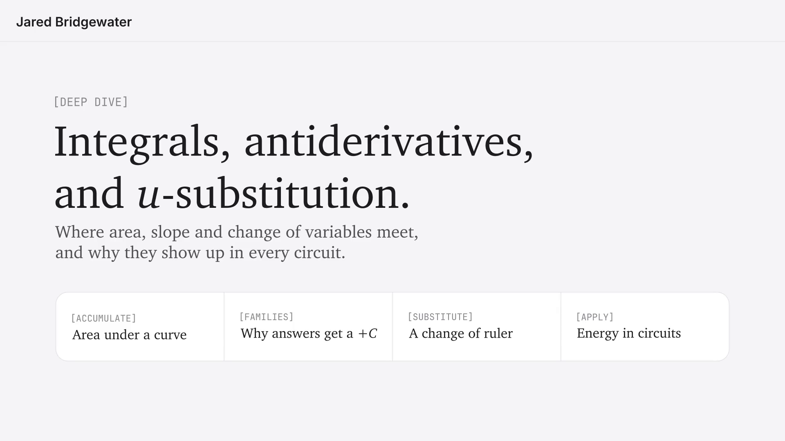
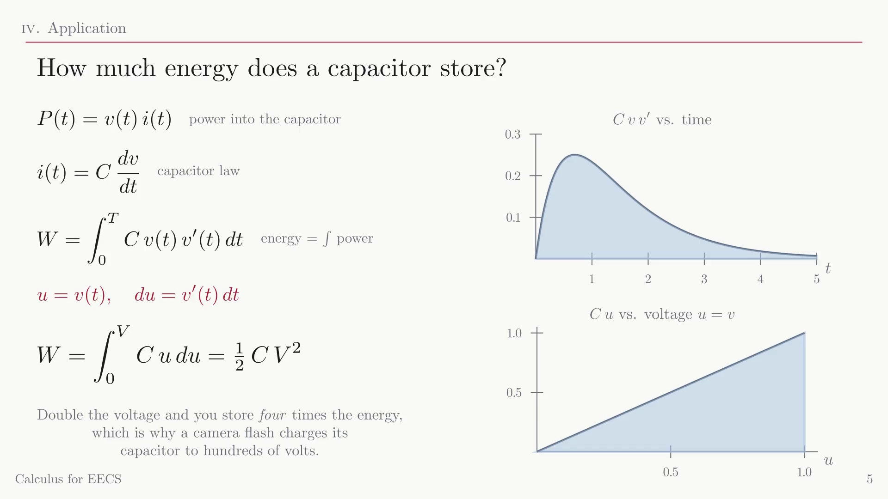
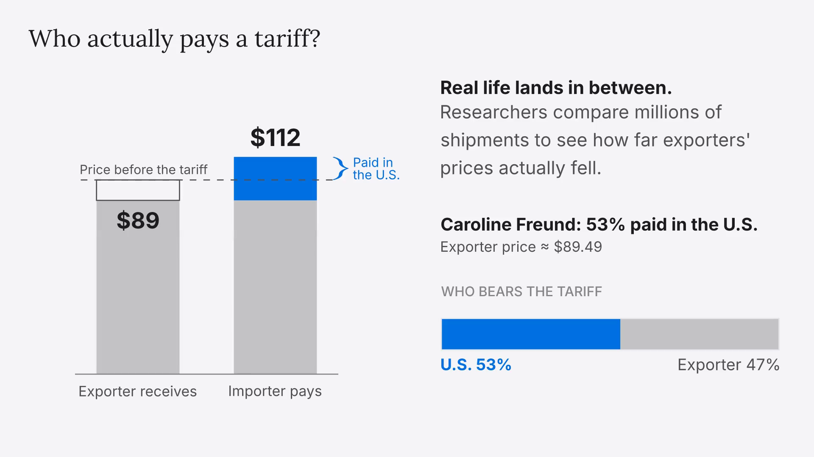
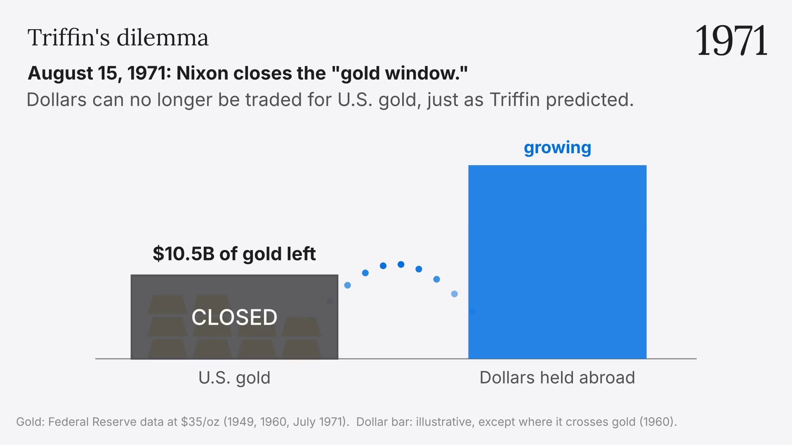
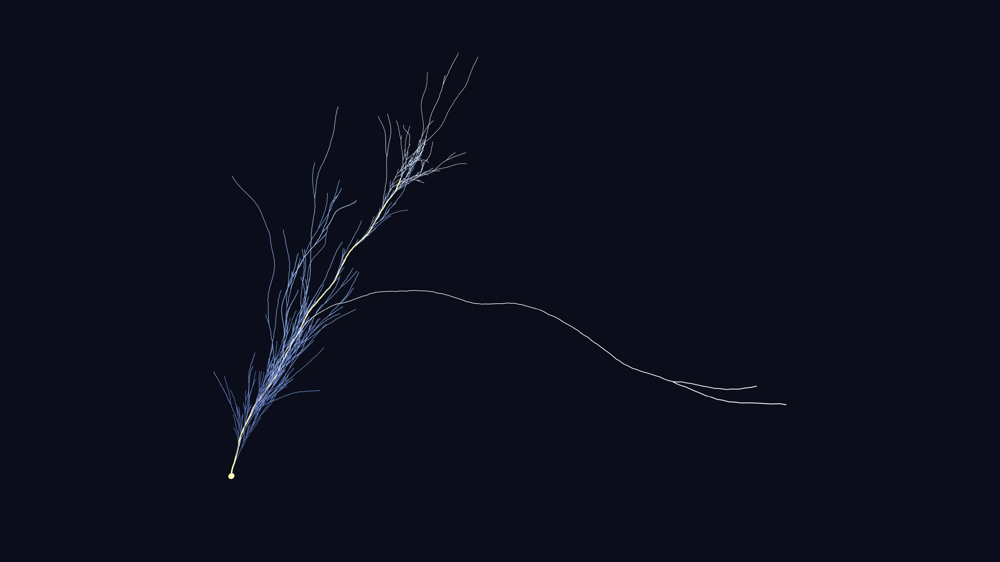

# Deep Dives

Animated explanations of ideas in math and engineering, built with [Manim](https://www.manim.community/) and Blender.

Each folder is one deep dive: the code that generates the visuals, plus the rendered output. The goal is to understand each idea well enough to animate it, and to tie the math to where it shows up in real engineering.

> **Status: work in progress.** This repo is new, and more deep dives are planned.

---

## Contents

| Deep dive | Tools | What it covers |
|---|---|---|
| [Integrals and u-substitution](integrals/) | Manim | Integrals as accumulated area, the Fundamental Theorem of Calculus, why antiderivatives carry a $+C$, and u-substitution as a change of variable. Ends with circuit applications. |
| [Triffin's dilemma](tariffs/) | Manim | Why being the world's reserve currency was a trap under the gold standard: U.S. gold drains while dollars pile up abroad, until the gold window closes in 1971. Also a companion to the tariffs article. |
| [Who pays a tariff?](tariffs/) | Manim | A 45-second companion to my [tariffs deep dive](https://gubbgub.github.io/tariffs.html): who actually bears a 25% tariff, animated from the same math, with the 2025 estimates from the New York Fed, Kiel Institute and Caroline Freund. |
| [Collatz coral](collatz-coral/) | Blender, LaTeX | A visualization of the $3n+1$ problem: every starting number traced back to 1 as a branching 3D structure. |
| [Sketches](sketches/) | Blender | Smaller experiments. |

---

## Integrals and u-substitution



There are two versions of this video.

**`integrals.py`**: a four-scene first version on a dark background.

**`integrals_eecs.py`**: a seven-slide lecture connecting each idea to circuits. It is styled to match [my website](https://gubbgub.github.io) in light mode: a light-gray canvas, white cards with hairline borders, serif headings and equations (Charter, typeset by LaTeX), Inter for the interface text, `[MONO]` labels, and a single blue accent.

| Slide | Idea | Engineering connection |
|---|---|---|
| 1 | Riemann sums → exact area; $A'(x) = f(x)$ | **Coulomb counting.** A battery's charge gauge integrates measured current: $Q(t)=\int_0^t i\,d\tau$ |
| 2 | Antiderivatives form a family $F(x)+C$ | **Initial conditions.** $Q(t) = Q_0 + \int i\,d\tau$; the integral only measures change, so the gauge needs a reference point |
| 3–4 | u-substitution: each strip $dx$ maps to $du = g'(x)\,dx$ with the same area | Substitution is the chain rule run backwards |
| 5 | Energy stored in a capacitor | With $i = C\,\frac{dv}{dt}$ and $u = v(t)$: $W = \int C\,v\,v'\,dt = \int_0^V C\,u\,du = \tfrac12 CV^2$ |
| 6 | *Your turn* | Derive the energy in an inductor, $\tfrac12 LI^2$ |




Rendered videos: [`integrals_eecs_lecture.mp4`](integrals/renders/integrals_eecs_lecture.mp4) · [`integrals_and_u_sub.mp4`](integrals/renders/integrals_and_u_sub.mp4)

## Who pays a tariff?



This one is a companion to an article on my site, [More Than a Tax on Imports](https://gubbgub.github.io/tariffs.html), where it explains Figure 2.

A $100 part comes from a foreign exporter, and the U.S. adds a 25% tariff. If the exporter keeps its price, the importer pays $125 and Americans bear the whole tariff. If the exporter cuts its price to $80, the tariff is $20 and the importer still pays $100, so the exporter effectively paid it. Real life lands in between: the bars slide to each study's estimate, and the split bar shows who bore the cost.

Nothing is typed in. For a U.S. share $s$, the scene solves for the exporter's price $p$ from

$$(1+t)\,p - 100 = s \cdot t\,p \quad\Rightarrow\quad p = \frac{100}{1 + t - s\,t}$$

and draws every bar and label from $p$. It ends with the rule behind it: $\text{buyers' share} = \frac{\varepsilon_s}{\varepsilon_s + \varepsilon_d}$, or *whoever has fewer alternatives pays*.

| File | What it does |
|---|---|
| `who_pays.py` | The scene (`WhoPays`) |
| `site_style.py` | The website's colors and fonts (Inter, with Lora for headlines), shared by both tariff scenes |

Rendered video: [`who_pays.mp4`](tariffs/renders/who_pays.mp4)

## Triffin's dilemma



The second tariffs companion, for the article's section on the dollar's global role. In 1944 the U.S. promised to trade gold for dollars at $35 an ounce. The world needed dollars to trade, so they flowed abroad every year, and every one was a claim on American gold. By 1960 the dollars abroad outnumbered the gold behind them. Robert Triffin warned that the U.S. faced two bad choices, and in August 1971 Nixon closed the "gold window." The video ends on the open question of whether a modern version of the trap exists.

Each gold brick is $1 billion. The gold figures are real Federal Reserve numbers at $35 an ounce ($24.6B in 1949, $17.8B at the end of 1960, $10.5B in July 1971), with straight lines between them. The dollar bar is illustrative, except for where it crosses the gold in 1960, and the video says so on screen.

| File | What it does |
|---|---|
| `triffin.py` | The scene (`Triffin`) |

Rendered video: [`triffin.mp4`](tariffs/renders/triffin.mp4)

## Collatz coral



The **Collatz conjecture** says that if you start from any positive integer and repeat this rule, you always reach 1:

$$f(n) = \begin{cases} n/2 & n \text{ even} \\ 3n+1 & n \text{ odd} \end{cases}$$

It has been checked by computer for every starting value below $2^{71}$, but it has never been proved.

Each strand in the coral is one number $2 \le n \le 1500$, traced backward from 1. The strand bends one way on even steps and the other way on odd steps, so numbers whose sequences end the same way share a branch. The gold strand is $n = 27$, which takes 111 steps and climbs as high as 9232 before falling to 1.

| File | What it does |
|---|---|
| `collatz_coral_animated.py` | Builds the coral in Blender, grows it from the root, and orbits the camera around it |
| `collatz_coral_still.py` | Renders a clean, transparent 4K still with $n = 27$ highlighted |
| `wallpaper/wallpaper.tex` | Lays out the still with a typeset explanation (LaTeX + TikZ) |
| `wallpaper/wallpaper_clean.tex` | The same layout with no text |

---

## Running it

**Manim scenes**

```bash
pip install -r requirements.txt          # also needs LaTeX (MiKTeX or TeX Live) and FFmpeg
# integrals_eecs.py also uses the Inter and JetBrains Mono fonts (free; install them system-wide)
cd integrals
manim -pql integrals_eecs.py CapacitorEnergy            # quick preview of one slide
manim -pqh integrals_eecs.py TitleCard Accumulation Families USubPicture USubAlgebra CapacitorEnergy YourTurn
```

**Blender scripts.** Open Blender (tested on 5.3), go to the *Scripting* workspace, create a new text block, paste the script, and press **Alt+P**.

**Wallpaper.** From `collatz-coral/wallpaper/`:

```bash
pdflatex wallpaper.tex && pdftoppm -r 240 -png -singlefile wallpaper.pdf wallpaper
```

---

## Repo layout

```
integrals/        Manim source + renders
tariffs/          Manim companions to the tariffs article + renders
collatz-coral/    Blender scripts, LaTeX wallpaper, renders
sketches/         smaller Blender experiments
```

## Inspiration

- **[3Blue1Brown](https://www.youtube.com/@3blue1brown)** (Grant Sanderson). His videos showed me that math can be *seen*, not just computed, and he created [Manim](https://github.com/3b1b/manim), the animation engine this repo is built on. The scenes here use the [community edition](https://www.manim.community/).
- **[Bog](https://www.youtube.com/@bogxd)** (@bogxd), another big inspiration for starting these deep dives.

## Acknowledgments

Built with help from Claude (Anthropic) as a coding and design collaborator.
